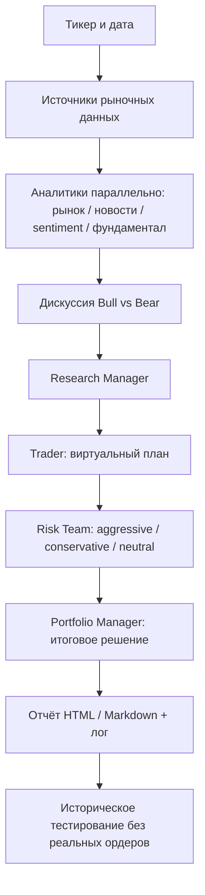

# TradingAgents — запуск и схема (PAPER-only)

Этот проект — **CLI для многоагентного анализа**, а не готовый веб-сервер.
В текущем режиме он формирует исследовательские решения и HTML-отчёты;
подключение к брокеру и размещение реальных заявок **не выполняется**.

## Архитектура



## Windows 11 / PowerShell

Необходимы Git и Python >= 3.11 (предпочтительно 3.13).

```powershell
git clone https://github.com/Jokersochi/TradingAgents.git
cd TradingAgents
py -3.13 -m venv .venv
.\.venv\Scripts\Activate.ps1
python -m pip install -e ".[dev]"
Copy-Item .env.paper.example .env
```

Для запуска **без API-ключа** на поддерживаемом плане ChatGPT выполните локальную авторизацию:

```powershell
tradingagents login chatgpt
```

Для исторической даты (только аналитика):

```powershell
tradingagents --ticker SPY --date 2026-10-30 --analysts market,news --save --no-show --html
```

Выбранная историческая дата — пример, не торговый сигнал. Вывод будет сохранён
в каталоге отчётов, настроенном TradingAgents (по умолчанию
`~/.tradingagents/logs/reports/`).

Если запускать без авторизации ChatGPT, можно выбрать другого LLM-провайдера в
`.env` и задать **локально** его ключ через переменную окружения. Не коммитьте
`.env` или локальный `~/.tradingagents/chatgpt-auth.json`.

## Офлайн-проверка без LLM, рынка и затрат на API

```powershell
python -m pytest -q tests/test_graph_end_to_end.py tests/test_report_html.py
python scripts/make_offline_preview.py
Start-Process .\preview\paper-demo\complete_report.html
```

Тесты `test_graph_end_to_end.py` имитируют ответы моделей и рыночных
источников, проходя многоагентный граф. HTML-превью создаётся **отдельно из
вымышленных данных**. Оно проверяет только отображение отчёта,
не доказывает доходность и не представляет реальный результат работы агентов.

В GitHub Actions workflow `Paper preview (offline, no credentials)`
запускает офлайн-проверки и сохраняет HTML как артефакт `paper-preview-html`.

## Границы безопасности

- **Никаких реальных ордеров**: не подключать ключи бирж, кошельки и брокерские аккаунты.
- **Никаких гарантий доходности**: сигналы требуют независимой проверки.
- **Никаких секретов в GitHub**: `.env.paper.example` содержит только настройки.
- Демо-HTML содержит **только синтетические** сведения; не использовать для торговли.
- Для реальной аналитики требуются авторизация LLM и сетевые источники данных;
  офлайн-превью этого не заменяет.
